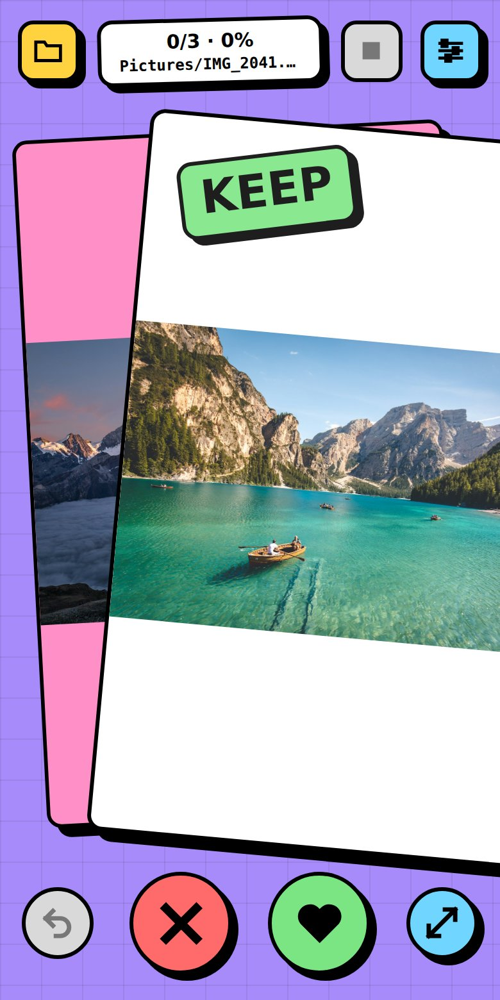
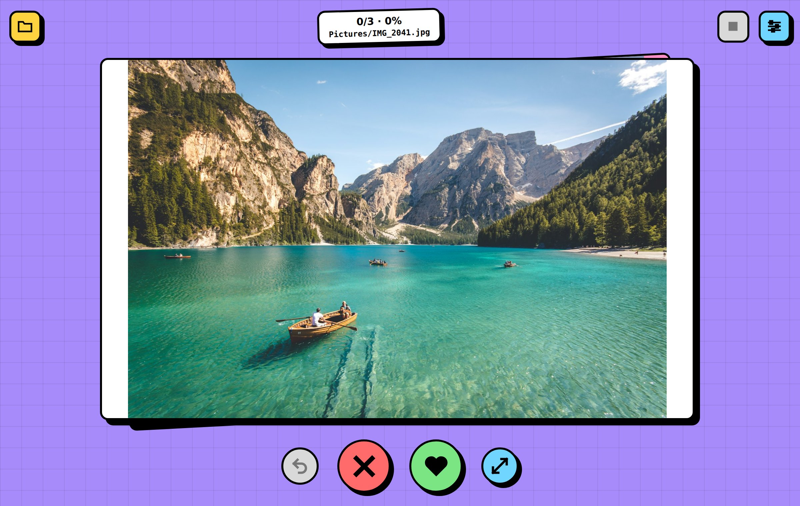
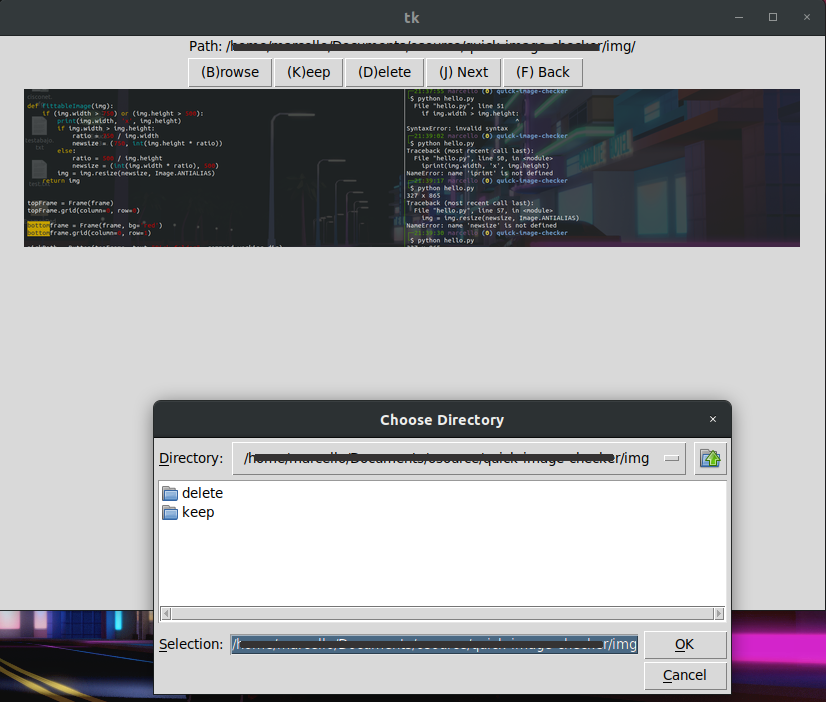

QUIT
====

QUick Image Tagger. Flip through a folder of screenshots/pictures and sort each one into `keep/` or `delete/`. Files are only moved while you sort; nothing is deleted until you finish the folder and confirm.

**Use it now: [blog.marcelloavila.com/tools/quit](https://blog.marcelloavila.com/tools/quit/)** (Chrome or Edge, desktop or Android).

  
  

Sample photos in the screenshots are from <a href="https://unsplash.com">Unsplash</a> (Unsplash License).

## Run

Use the [hosted version](https://blog.marcelloavila.com/tools/quit/), or open `index.html` in **Chrome or Edge** (desktop or Android). One file, no install, no server. Firefox and Safari can't write to local folders, so they get a notice instead.

Pick a folder (top-left). It shows the folder's `.png`, `.jpg`, `.jpeg` and `.gif` files (not subfolders).

| Do | Key | Action |
|----|-----|--------|
| Swipe right / ♥ | `K` | Keep: move into `keep/` |
| Swipe left / ✕ | `D` | Delete: move into `delete/` |
| Tap left half of picture | `F` | Back |
| Tap right half of picture | `J` | Next (skip) |
| ↶ | `Z` | Undo the last keep/delete (as far back as you like) |
| ⤢ | `V` | Open full size in a new tab, to zoom |
| 📁 | `B` | Pick folder |
| ■ (top) | `S` | Stop: end early (unsorted pictures stay put) and get the same delete question as when done |

Keys can be remapped in Settings (top-right); they're saved in the browser.

If `keep/` or `delete/` already holds a file with the same name, the move is refused and nothing is overwritten.

### Finishing a folder

After the last picture, or when you press Stop and confirm, QUIT asks **All done! Do you want to DELETE?** (Yes / No / I'm not sure). Yes, or DELETE from the "I'm not sure" explanation, asks for one more confirmation with the count, then:

- permanently deletes the pictures you marked delete in this session (other files already in `delete/` are left alone; browsers have no recycle bin),
- moves the kept pictures back into the original folder,
- removes `keep/` and `delete/` if they ended up empty.

No / Not now / Esc leaves everything in `keep/` and `delete/`.

## On a phone

The browser only allows folder access on `https://` or `localhost`, so a plain LAN address (`http://192.168.x.x`) won't work. Use the [hosted version](https://blog.marcelloavila.com/tools/quit/) in Chrome for Android.

## Self-test

Serve the folder (`python3 -m http.server`) and open `http://localhost:8000/#selftest`. It runs in the browser's private storage, never on your files, and shows `SELFTEST PASS` or what failed.

## Style

Neo-brutalism, after lesson 04 of [Brutalist Substyles](https://www.brutalistwebdesign.com/pdf/brut111.pdf): flat loud colors, thick black outlines, hard offset shadows, simple interface, minimal motion (and none with `prefers-reduced-motion`).

## History

### Old QUIT

The first version was a Python/Tkinter window with a row of buttons; this repo started as that.

